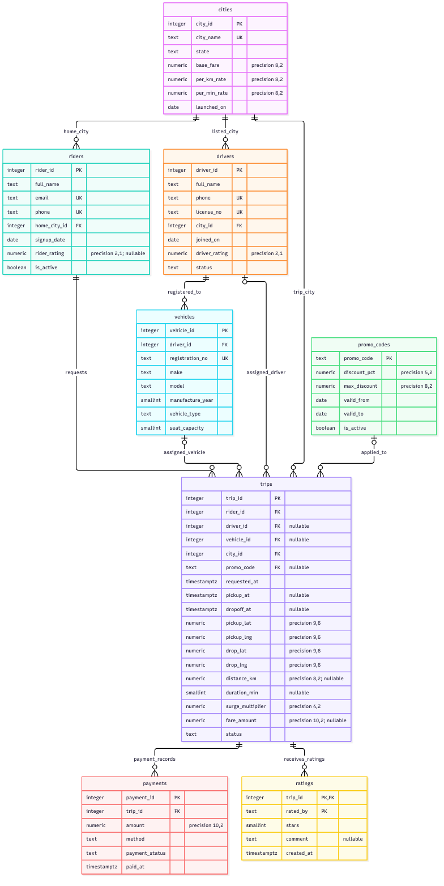

# Schema Design and Validation — Uber Ride-Hailing Database

**Status:** CP1 schema design implemented in `sql/01_schema.sql` and `sql/02_load_data.sql`. Runtime load and validation results are recorded in Section 10. Some business policies remain assumptions and are listed in Section 9.

## 1. Design goals and evidence

The design uses PostgreSQL types, preserves every CSV header as a column name, supports the supplied 30-query workload, and separates entities that have their own identifiers (riders, drivers, vehicles, cities, trips, payments, promo codes, ratings). The CSV export is evidence about the supplied snapshot, but a pattern in this snapshot is not automatically a permanent business rule. Decisions that need product or course-team confirmation are called out below.

The seed files contain 10 cities, 30,000 riders, 3,000 drivers, 3,300 vehicles, 40 promo codes, 300,000 trips, 245,839 payments, and 307,214 ratings. Relevant observed values:

- Trip `status`: `COMPLETED`, `CANCELLED_BY_RIDER`, `CANCELLED_BY_DRIVER`, `REQUESTED`, `ACCEPTED`, `ONGOING`.
- Payment `method`: `CARD`, `CASH`, `UPI`, `WALLET`; `payment_status`: `SUCCESS`, `FAILED`, `REFUNDED`.
- Rating `rated_by`: `RIDER` or `DRIVER`; `stars` is an integer from 1 to 5.
- Trips have 54,061 empty `pickup_at` values and 54,161 empty values each for `dropoff_at`, `distance_km`, `duration_min`, `fare_amount`. `driver_id` and `vehicle_id` are each empty 15,098 times. `promo_code` is empty 280,027 times.
- `ratings.comment` is empty 245,486 times; `riders.rider_rating` is empty 882 times.
- There are 245,839 payment rows, each with a different trip ID. There are 307,214 ratings but only 212,607 distinct trip IDs, so `trip_id` alone cannot identify a rating. `(trip_id, rated_by)` is unique in this export.
- Every non-empty rating/payment trip ID exists in `trips`; every populated trip vehicle matches the trip's driver in this snapshot. These are observed integrity results, not proof that one payment per trip or permanent vehicle ownership is a universal policy.

## 2. Tables and columns

`PK` means primary key; `FK` means foreign key. `NOT NULL` means a value is required on every row. All the listed columns keep the CSV spelling exactly. Types favor money-safe decimal values, dates for date-only values, and `timestamptz` for timestamps carrying an offset.

### `cities` (10 rows)

| Column | Proposed PostgreSQL type | Null? | Key / rule | Reason |
|---|---|---|---|---|
| `city_id` | `integer` | NOT NULL | PK | Small integer identifier. |
| `city_name` | `text` | NOT NULL | UNIQUE | City label used by workload joins/filters; names in this export are distinct. |
| `state` | `text` | NOT NULL | — | State/territory name; keep textual rather than assume a fixed abbreviation list. |
| `base_fare` | `numeric(8,2)` | NOT NULL | CHECK > 0 | Currency amount. |
| `per_km_rate` | `numeric(8,2)` | NOT NULL | CHECK > 0 | Currency rate per kilometre. |
| `per_min_rate` | `numeric(8,2)` | NOT NULL | CHECK > 0 | Currency rate per minute. |
| `launched_on` | `date` | NOT NULL | — | Calendar date without a time of day. |

### `riders` (30,000 rows)

| Column | Proposed PostgreSQL type | Null? | Key / rule | Reason |
|---|---|---|---|---|
| `rider_id` | `integer` | NOT NULL | PK | Identifier. |
| `full_name` | `text` | NOT NULL | — | Names are variable length; workload searches this field. |
| `email` | `text` | NOT NULL | UNIQUE (case-sensitive) | Workload looks up `LOWER(email)`; CSV email spellings contain mixed case. |
| `phone` | `text` | NOT NULL | UNIQUE | Phone numbers are identifiers, not quantities; leading zeroes must remain possible. |
| `home_city_id` | `integer` | NOT NULL | FK → `cities.city_id` | Home city reference. |
| `signup_date` | `date` | NOT NULL | — | Calendar date. |
| `rider_rating` | `numeric(2,1)` | NULL | CHECK 1.0–5.0 when present | Export has 882 missing values; decimal rating. |
| `is_active` | `boolean` | NOT NULL | — | CSV uses `t`/`f`; a missing value would make active state ambiguous. |

### `drivers` (3,000 rows)

| Column | Proposed PostgreSQL type | Null? | Key / rule | Reason |
|---|---|---|---|---|
| `driver_id` | `integer` | NOT NULL | PK | Identifier. |
| `full_name` | `text` | NOT NULL | — | Variable-length name. |
| `phone` | `text` | NOT NULL | UNIQUE | Identifier; do not model as a number. |
| `license_no` | `text` | NOT NULL | UNIQUE | Natural identifier; retain letters and leading zeroes. |
| `city_id` | `integer` | NOT NULL | FK → `cities.city_id` | Driver's listed city. |
| `joined_on` | `date` | NOT NULL | — | Calendar date. |
| `driver_rating` | `numeric(2,1)` | NOT NULL | CHECK 1.0–5.0 | Snapshot contains a rating for every driver, including minimum 3.2. |
| `status` | `text` | NOT NULL | CHECK in `ACTIVE`, `INACTIVE`, `SUSPENDED` | Values observed and used by W03. `text` avoids introducing a PostgreSQL enum migration burden. |

### `vehicles` (3,300 rows)

| Column | Proposed PostgreSQL type | Null? | Key / rule | Reason |
|---|---|---|---|---|
| `vehicle_id` | `integer` | NOT NULL | PK | Identifier. |
| `driver_id` | `integer` | NOT NULL | FK → `drivers.driver_id` | Registered driver. A driver can have more than one vehicle. |
| `registration_no` | `text` | NOT NULL | UNIQUE | Registration identifier; preserve letters/digits. |
| `make` | `text` | NOT NULL | — | Manufacturer label. |
| `model` | `text` | NOT NULL | — | Model label. |
| `manufacture_year` | `smallint` | NOT NULL | Application-level validation; no moving-year CHECK | Whole-number year. The export ranges from 2012 to 2025, but that does not establish a permanent minimum or maximum. Validate plausible model years in application/import logic using the applicable policy at that time. |
| `vehicle_type` | `text` | NOT NULL | CHECK in `AUTO`, `BIKE`, `MINI`, `SEDAN`, `SUV` | Exported categories; whether the list is closed is a business decision. |
| `seat_capacity` | `smallint` | NOT NULL | CHECK > 0 | Positive whole-number capacity. |

### `promo_codes` (40 rows)

| Column | Proposed PostgreSQL type | Null? | Key / rule | Reason |
|---|---|---|---|---|
| `promo_code` | `text` | NOT NULL | PK | Natural code, also referenced by trips. |
| `discount_pct` | `numeric(5,2)` | NOT NULL | CHECK > 0 and <= 100 | Percentage; decimals allow future fractional promotions. |
| `max_discount` | `numeric(8,2)` | NOT NULL | CHECK >= 0 | Currency cap. |
| `valid_from` | `date` | NOT NULL | — | Start calendar date. |
| `valid_to` | `date` | NOT NULL | CHECK >= `valid_from` | End calendar date. |
| `is_active` | `boolean` | NOT NULL | — | CSV boolean. Active status can differ from the validity dates; do not infer one from the other. |

### `trips` (300,000 rows)

| Column | Proposed PostgreSQL type | Null? | Key / rule | Reason |
|---|---|---|---|---|
| `trip_id` | `integer` | NOT NULL | PK | IDs currently fit `integer`; reassess if future scale may exceed its limit. |
| `rider_id` | `integer` | NOT NULL | FK → `riders.rider_id` | Requesting rider; all trips have a rider. |
| `driver_id` | `integer` | NULL | FK → `drivers.driver_id` | A request may not yet have a driver. |
| `vehicle_id` | `integer` | NULL | FK → `vehicles.vehicle_id` | A request may not yet have an assigned vehicle. |
| `city_id` | `integer` | NOT NULL | FK → `cities.city_id` | Trip city; used by many workload queries. |
| `promo_code` | `text` | NULL | FK → `promo_codes.promo_code` | Optional; blank on 280,027 exported trips. |
| `requested_at` | `timestamptz` | NOT NULL | — | Timestamp includes `+05:30`; query date ranges use it. PostgreSQL stores the instant and displays it in the session timezone. |
| `pickup_at` | `timestamptz` | NULL | Conditional rule below | Empty for trips without a pickup. |
| `dropoff_at` | `timestamptz` | NULL | Conditional rule below | Empty for trips not dropped off. |
| `pickup_lat` | `numeric(9,6)` | NOT NULL | CHECK -90..90 | Latitude precision matches export; type has enough precision for coordinates. |
| `pickup_lng` | `numeric(9,6)` | NOT NULL | CHECK -180..180 | Longitude. |
| `drop_lat` | `numeric(9,6)` | NOT NULL | CHECK -90..90 | Latitude. |
| `drop_lng` | `numeric(9,6)` | NOT NULL | CHECK -180..180 | Longitude. |
| `distance_km` | `numeric(8,2)` | NULL | CHECK > 0 when present | Distance is a measured decimal; missing for trips not completed. |
| `duration_min` | `smallint` | NULL | CHECK > 0 when present | Whole minutes; missing for trips not completed. |
| `surge_multiplier` | `numeric(4,2)` | NOT NULL | CHECK >= 1.00 (confirm minimum) | Decimal multiplier; export ranges 1.00–1.98. |
| `fare_amount` | `numeric(10,2)` | NULL | CHECK >= 0 when present | Currency amount; missing for some non-completed trips. |
| `status` | `text` | NOT NULL | CHECK in six observed values | Workload filters these statuses. Confirm whether the list is exhaustive. |

**Implemented trip consistency checks:** for `COMPLETED`, require driver, vehicle, pickup/dropoff timestamps, distance, duration, and fare; when both timestamps exist, require `dropoff_at > pickup_at`. For other statuses the schema does not require all execution fields. The decision not to require `pickup_at` merely because `driver_id` exists preserves the accepted/ongoing lifecycle data. Vehicle/driver matching is an observed relationship in this export, not a CHECK: PostgreSQL CHECK constraints cannot enforce a condition against another table. See the separate composite-FK discussion below.

### `payments` (245,839 rows)

| Column | Proposed PostgreSQL type | Null? | Key / rule | Reason |
|---|---|---|---|---|
| `payment_id` | `integer` | NOT NULL | PK | Identifier. |
| `trip_id` | `integer` | NOT NULL | FK → `trips.trip_id`; **not UNIQUE proposed** | Each exported row references a trip. Leave room for retries or multiple payment records unless policy says one per trip. |
| `amount` | `numeric(10,2)` | NOT NULL | CHECK >= 0 | Currency amount. |
| `method` | `text` | NOT NULL | CHECK in `CARD`, `CASH`, `UPI`, `WALLET` | Observed payment methods; confirm list can be closed. |
| `payment_status` | `text` | NOT NULL | CHECK in `SUCCESS`, `FAILED`, `REFUNDED` | Observed statuses; confirm list can be closed. |
| `paid_at` | `timestamptz` | NOT NULL | — | Timestamp with offset; R08 and R22 filter/group this column. |

### `ratings` (307,214 rows)

| Column | Proposed PostgreSQL type | Null? | Key / rule | Reason |
|---|---|---|---|---|
| `trip_id` | `integer` | NOT NULL | Part of PK; FK → `trips.trip_id` | One component of rating identity. |
| `rated_by` | `text` | NOT NULL | Part of PK; CHECK `RIDER` or `DRIVER` | Distinguishes the two possible reviewers for one trip. |
| `stars` | `smallint` | NOT NULL | CHECK 1..5 | Integer star rating. |
| `comment` | `text` | NULL | — | Optional; frequently blank. |
| `created_at` | `timestamptz` | NOT NULL | — | Timestamp includes a UTC offset. |

Proposed ratings primary key: **(`trip_id`, `rated_by`)**. A trip can have zero, one, or two rating rows; the snapshot has 118,000 trip IDs with one rating and 94,607 with two. A rider/driver may each give at most one rating per trip under this key. This is a deliberate rule suggested by the file structure and the README hint, and still needs confirmation if repeated ratings or rating revisions should be supported.

## 3. Keys, uniqueness, and delete behavior

Primary keys are `cities.city_id`, `riders.rider_id`, `drivers.driver_id`, `vehicles.vehicle_id`, `promo_codes.promo_code`, `trips.trip_id`, and `payments.payment_id`; `ratings` uses the composite key above. Additional UNIQUE constraints are on `city_name`, `riders.email`, `riders.phone`, `drivers.phone`, `drivers.license_no`, and `vehicles.registration_no`. Those values have no duplicates in this export. Email uniqueness is case-sensitive in the implemented schema, so two differently cased spellings could still be stored; confirm whether login identity should be case-insensitive.

| Foreign key | Proposed `ON DELETE` | Why |
|---|---|---|
| `riders.home_city_id` → `cities.city_id` | RESTRICT | Do not silently erase a rider when a city row is removed. |
| `drivers.city_id` → `cities.city_id` | RESTRICT | Preserve driver records if a city is removed. |
| `vehicles.driver_id` → `drivers.driver_id` | RESTRICT | A vehicle is registered to a driver; deletion should be an explicit business operation. |
| `trips.rider_id` → `riders.rider_id` | RESTRICT | Retain trip history; do not cascade-delete it with a rider. |
| `trips.driver_id` → `drivers.driver_id` | RESTRICT | Retain the historical driver reference; deleting a driver referenced by any trip is blocked. Deactivate the driver instead of deleting it. |
| `trips.vehicle_id` → `vehicles.vehicle_id` | RESTRICT | Retain the historical vehicle reference; deleting a vehicle referenced by any trip is blocked. Deactivate/archive it instead of deleting it. |
| `trips.city_id` → `cities.city_id` | RESTRICT | Trip city is needed for historical reporting. |
| `trips.promo_code` → `promo_codes.promo_code` | RESTRICT | Preserve the promotion reference on historical trips; deactivate/archive a promo code instead of deleting a referenced code. The trip column remains nullable for trips that did not use a promo. |
| `payments.trip_id` → `trips.trip_id` | RESTRICT | Prevent deleting a trip while its financial records remain. |
| `ratings.trip_id` → `trips.trip_id` | RESTRICT | Keep ratings attached to the historical trip; avoid accidental cascade deletion. |

**Implemented policy: `ON DELETE RESTRICT` for every foreign key listed above.** A referenced parent cannot be deleted while child rows exist. This preserves history and avoids silently deleting or clearing references in trips, payments, and ratings. Retire cities, users, vehicles, and promo codes by changing their status/active flag where available or by another explicit archival process. This retention policy is an explicit design decision, not a policy stated in the CSVs; confirm it with the application owner.

**Vehicle/driver matching:** the implemented simple FKs separately prove that a trip's populated `vehicle_id` and `driver_id` exist. They do not prove that the driver's ID equals the vehicle row's current `driver_id`. The export has no mismatches, but that is not enough to establish a lasting rule. If ownership can change, a composite FK `(vehicle_id, driver_id)` to `vehicles(vehicle_id, driver_id)` would compare the trip's historical driver to the vehicle's *current* owner and could reject valid historical trips after a transfer. It also requires a matching unique key on `vehicles`; if either child FK column is NULL, ordinary composite-FK NULL behavior can skip the pair check, so separate FKs are still needed to validate whichever individual ID is present. With the chosen RESTRICT policy, deletion does not clear either column. The schema therefore keeps separate FKs and omits the composite FK until the team confirms vehicle ownership rules. If ownership changes, model ownership/assignment history rather than equating historical trip assignment with current registration.

## 4. CHECK constraints in the implemented schema

The schema implements the 27 database CHECK constraints listed below, above the required minimum of 12. Manufacture-year plausibility is application/import validation instead of a moving CHECK; the export does not justify a durable fixed year bound.

1. `cities.base_fare > 0`.
2. `cities.per_km_rate > 0`.
3. `cities.per_min_rate > 0`.
4. `riders.rider_rating IS NULL OR rider_rating BETWEEN 1.0 AND 5.0`.
5. `drivers.driver_rating BETWEEN 1.0 AND 5.0`.
6. `drivers.status IN ('ACTIVE','INACTIVE','SUSPENDED')`.
7. `vehicles.manufacture_year`: validate plausibility in application/import logic using the approved policy; no database CHECK is proposed because the snapshot does not justify a fixed boundary.
8. `vehicles.vehicle_type IN ('AUTO','BIKE','MINI','SEDAN','SUV')` (confirm whether these are exhaustive).
9. `vehicles.seat_capacity > 0`.
10. `promo_codes.discount_pct > 0 AND discount_pct <= 100`.
11. `promo_codes.max_discount >= 0`.
12. `promo_codes.valid_to >= valid_from`.
13. `trips.status IN ('REQUESTED','ACCEPTED','ONGOING','COMPLETED','CANCELLED_BY_RIDER','CANCELLED_BY_DRIVER')` (confirm closed status list).
14. `trips.pickup_lat BETWEEN -90 AND 90`.
15. `trips.pickup_lng BETWEEN -180 AND 180`.
16. `trips.drop_lat BETWEEN -90 AND 90`.
17. `trips.drop_lng BETWEEN -180 AND 180`.
18. `trips.surge_multiplier >= 1.00` (confirm whether surge can ever be below 1).
19. `trips.distance_km IS NULL OR distance_km > 0`.
20. `trips.duration_min IS NULL OR duration_min > 0`.
21. `trips.fare_amount IS NULL OR fare_amount >= 0`.
22. If both `pickup_at` and `dropoff_at` are present, `dropoff_at > pickup_at`.
23. A `COMPLETED` trip has `driver_id`, `vehicle_id`, `pickup_at`, `dropoff_at`, `distance_km`, `duration_min`, and `fare_amount` all present.
24. `payments.amount >= 0`.
25. `payments.method IN ('CARD','CASH','UPI','WALLET')` (confirm closed list).
26. `payments.payment_status IN ('SUCCESS','FAILED','REFUNDED')` (confirm closed list).
27. `ratings.rated_by IN ('RIDER','DRIVER')`.
28. `ratings.stars BETWEEN 1 AND 5`.

Item 7 is a validation rule, not a database CHECK, so the list contains 27 CHECK constraints and one application-level validation. `NOT NULL`, primary-key, foreign-key, and uniqueness requirements are separate from CHECK constraints. For example, a `CHECK (fare_amount >= 0)` alone does not prohibit NULL; the nullable fare is intentional for unfinished/cancelled trips.

## 5. Relationships and cardinality

In the diagram, `||` means exactly one, `o|` means zero or one, and `o{` means zero or many. The detailed image and Mermaid source are kept together with the other CP1 diagram files:

Mermaid source: [diagrams/er_diagram.mmd](../diagrams/er_diagram.mmd). It lists all columns, PostgreSQL types/precision, PK/UK/FK markers, and the ten relationships, matching `sql/01_schema.sql`.

Each city, rider, driver, vehicle, promo code, and trip parent can have zero or many child records on the corresponding relationship; each child has exactly one required parent except a trip's driver, vehicle, or promo code, which can be absent. Payment is zero-to-many per trip because one payment in the export does not establish that retries or split payments are impossible. Ratings are zero-to-two per trip under the composite key (at most one from each role), assuming this key policy is confirmed. Riders and drivers are many-to-many across trips over time, represented through `trips`; a trip itself refers to one rider and at most one assigned driver/vehicle at a time.

## 6. Functional dependencies and normal forms

A functional dependency `X → Y` means that a value (or set of values) `X` determines `Y`. A key determines every other column in its row. The CSV can verify uniqueness and repeated-value patterns for this snapshot; it cannot prove that a dependency is a permanent business rule or prove that no unobserved dependency exists. The dependencies below separate **snapshot evidence** from **schema assumptions**.

| Table | Candidate key(s) and principal functional dependencies | 1NF → 2NF → 3NF / BCNF analysis; evidence and assumptions |
|---|---|---|
| `cities` | **Observed:** `city_id` is unique in the 10 rows, so the proposed PK gives `city_id → city_name, state, base_fare, per_km_rate, per_min_rate, launched_on`. `city_name` is also unique in this snapshot. **Assumed alternate key:** `city_name →` remaining columns if its UNIQUE rule is adopted. | Each field is a single value (1NF). The determinants are single-column keys, so no partial dependency (2NF). No city descriptive attribute is copied into another city row; under the listed dependencies, 3NF and BCNF hold. The alternate key assumes names are unique and stable. |
| `riders` | **Observed:** `rider_id` is unique and determines the other seven columns. Email and phone have no duplicates in this snapshot. **Assumed alternate keys:** `email →` and `phone →` the other rider columns if their UNIQUE rules are adopted. | Values are atomic (1NF); single-column keys mean no partial dependency (2NF). City details stay in `cities`, rather than being repeated based on `home_city_id`. Under the listed dependencies every determinant is a candidate key, so 3NF/BCNF. Email/phone uniqueness and case handling are business assumptions, not guarantees from one export. |
| `drivers` | **Observed:** `driver_id` is unique and determines the other seven columns. `phone` and `license_no` have no duplicates in this snapshot. **Assumed alternate keys:** each determines the driver row only if its UNIQUE rule is adopted and maintained. | Values are atomic (1NF); single-column keys mean no partial dependency (2NF). City details are in `cities`. Under the listed dependencies the table is 3NF/BCNF. Phone/license stability and uniqueness are proposed policies, not proved by finite data. |
| `vehicles` | **Observed:** `vehicle_id` is unique and determines the other seven columns; `registration_no` has no duplicates in this snapshot. **Assumed alternate key:** `registration_no →` the remaining vehicle columns if UNIQUE is adopted. | Values are atomic (1NF); single-column keys mean no partial dependency (2NF). Driver details are in `drivers`. No `make, model → vehicle_type` dependency is assumed without a maintained model catalog. Under the listed dependencies this table is 3NF/BCNF. Registration uniqueness/stability is a proposed rule. |
| `promo_codes` | **Observed:** `promo_code` is unique in the 40 rows and determines `discount_pct, max_discount, valid_from, valid_to, is_active`. | Fields are atomic (1NF); the single-column key means no partial dependency (2NF). No dependency among non-key attributes is established by the source. Under the listed dependency the table is 3NF/BCNF. A future model with multiple campaigns per code would require revisiting this key. |
| `trips` | **Observed:** `trip_id` is unique and determines the other 17 columns. No other candidate key is proposed. Neither `driver_id` nor `vehicle_id` identifies a trip. | Fields are atomic (1NF); the single-column key means no partial dependency (2NF). Rider, driver, vehicle, city, and promo descriptions are stored in their own tables. Fare/duration may be derived in some processes, but the formula is undocumented, so they remain stored facts. Under the listed dependency the table is 3NF/BCNF. The absence of further business dependencies is a modeling assumption that the export alone cannot prove. |
| `payments` | **Observed:** `payment_id` is unique and determines `trip_id, amount, method, payment_status, paid_at`. Every exported `trip_id` occurs once in payments, but the design does **not** assume `trip_id → payment_id`. | Fields are atomic (1NF); the single-column key means no partial dependency (2NF). Multiple payment records per trip remain allowed. Under the listed dependency the table is 3NF/BCNF. If the business confirms at most one payment row per trip, `trip_id` could be made an alternate key with UNIQUE. |
| `ratings` | **Observed:** `(trip_id, rated_by)` pairs are unique; neither `trip_id` nor `rated_by` alone identifies a row. **Proposed dependency:** `(trip_id, rated_by) → stars, comment, created_at`. | Fields are atomic (1NF). Rating attributes depend on the whole composite key, not one part, so 2NF. No non-key dependency is identified; under the proposed one-rating-per-role-per-trip rule the composite determinant is a key, giving 3NF/BCNF. Whether rating revisions/repeats are allowed needs confirmation. |

These normal-form conclusions are **conditional on the listed dependencies and proposed keys**. They do not claim that profiling alone proves BCNF. The design separates city, rider, driver, vehicle, and promo details from trips; payment and rating facts stay in their own tables instead of being repeated as trip columns.

## 7. Derived, repeated, or potentially redundant data

- `riders.rider_rating` and `drivers.driver_rating` appear to be summary ratings, while detailed per-trip ratings live in `ratings`. These scores might be calculated from ratings, but the export does not state the formula, weighting, recency, or update policy. Keep them as source snapshot attributes for now; do not derive or overwrite them from `ratings` without confirmation. W03 explicitly reads `drivers.driver_rating`.
- `trips.fare_amount` could be calculated from city base/per-km/per-minute rates, distance, duration, and surge, possibly with promotion adjustments. The exact formula and rounding rules are absent; fare may represent a finalized transaction value. Keep it as stored historical data. Do not constrain it to an invented formula.
- `payments.amount` often appears to equal a trip fare for successful examples, but refunds, failed attempts, partial payments, and promotions could make them differ. Keep separate amounts and do not assert equality.
- `trips.city_id` alongside the driver's `city_id` and rider's `home_city_id` is not redundant: they represent trip location and user home/listed city, which can differ.
- `vehicles.driver_id` is current registered ownership. Copying that relationship into trip `driver_id` and `vehicle_id` records who/what was assigned to that trip, but vehicle ownership could change. The export matches those values; whether that must always hold is a confirmation item.
- `duration_min` and the interval between timestamps may differ due to rounding or business definitions. Preserve the supplied duration; do not force equality without a documented definition.

## 8. Workload compatibility

The exact names used by `queries/workload_30.sql` are retained. `trips.requested_at`, `status`, `driver_id`, `rider_id`, `city_id`, `fare_amount`, `distance_km`, and `duration_min` support its filters/aggregations; `riders.email` supports R03's `LOWER(email)` expression; `payments.paid_at`, `method`, and `payment_status` support R08/R22; `ratings.trip_id` joins to trips and `rated_by` filters R11; `vehicles.registration_no` supports R14; `promo_codes.promo_code` joins R21. W01 deliberately inserts a request without a driver, vehicle, or trip completion data, so those trip columns must permit NULL. W02 completes an ongoing trip and supplies execution fields. W03 changes a driver's status to `SUSPENDED`.

**R10 query-logic warning:** the original query uses `driver_id NOT IN (SELECT t.driver_id ...)`. In this seed data, that time-filtered subquery contains 277 trips with NULL `driver_id`. SQL NULL logic means `NOT IN` can evaluate to unknown for every candidate driver, so R10 can return no rows even when some active drivers have no recent trips. This is a query correctness issue, not a reason to make `trips.driver_id NOT NULL`: NULL is valid for unassigned trips and needed by W01/W04. Keep `queries/workload_30.sql` unchanged; correct the query in the optimized-query deliverable (for example, an anti-join using `NOT EXISTS`) and prove the intended results as the README requires.

Do not add performance indexes in this schema-design stage. PostgreSQL will create indexes for primary keys and unique constraints; those are constraint-supporting indexes. The workload file itself remains unchanged.

## 9. Decisions to confirm for future policy changes

1. Should rider email uniqueness and login matching be case-insensitive? The workload uses `LOWER(email)` and exported emails have mixed case. A normal `UNIQUE(email)` is case-sensitive.
2. Are one payment per trip and one rating per role per trip permanent rules? The schema allows multiple payment rows but implements the composite rating key suggested by the file shape/README hint.
3. Are payment methods/statuses, driver statuses, trip statuses, and vehicle types closed lists, or can new values appear?
4. Are completed trips always required to have driver, vehicle, pickup/dropoff times, distance, duration, and fare? This matches the snapshot and workload and is enforced by the current schema; confirm it as a lifecycle rule.
5. Can a vehicle's registered driver change? If yes, historical trip assignment may differ from current vehicle ownership; should ownership history be modeled? The schema therefore does not enforce a composite vehicle/driver FK.
6. Is `ON DELETE RESTRICT` for every FK acceptable as the retention policy, with deactivation/archive instead of physical deletion?
7. Is `surge_multiplier` guaranteed to be at least 1.00? The export's minimum is 1.00, but that alone does not establish the product rule.
8. Are coordinate, money, and rating bounds acceptable as durable rules? Manufacture-year plausibility is left to application/import validation until a policy is confirmed.
9. Does the supplied vehicle type imply a strict capacity rule (for example, particular types must have specific seat counts)? No such mapping is assumed because none is documented in the CSV or workload.
10. Should all CSV-empty strings be loaded as SQL NULL? This is required for the proposed optional columns; confirm the eventual `\copy` null handling.

## 10. Runtime load and integrity validation

The following results were supplied from the PostgreSQL runtime run against database `uber_ride_hailing`, schema `uber`, using PostgreSQL **16.15**. All eight tables were created, all CSVs loaded, and `ANALYZE` completed successfully. All expected row counts matched:

| Table | Actual rows | Expected rows | Result |
|---|---:|---:|:---:|
| `cities` | 10 | 10 | PASS |
| `riders` | 30,000 | 30,000 | PASS |
| `drivers` | 3,000 | 3,000 | PASS |
| `vehicles` | 3,300 | 3,300 | PASS |
| `promo_codes` | 40 | 40 | PASS |
| `trips` | 300,000 | 300,000 | PASS |
| `payments` | 245,839 | 245,839 | PASS |
| `ratings` | 307,214 | 307,214 | PASS |

| Integrity check | Violations | Result |
|---|---:|:---:|
| Duplicate `(trip_id, rated_by)` rating keys | 0 | PASS |
| Trip/vehicle/driver mismatches | 0 | PASS |
| Completed trips missing required details | 0 | PASS |
| Ratings outside 1–5 stars | 0 | PASS |

The vehicle/driver check confirms the loaded snapshot has no mismatches; it is not enforced as a composite FK in the current schema because vehicle ownership can change and the export does not establish a historical ownership rule. These runtime results are recorded as provided; they are not a new database run by this document update.
